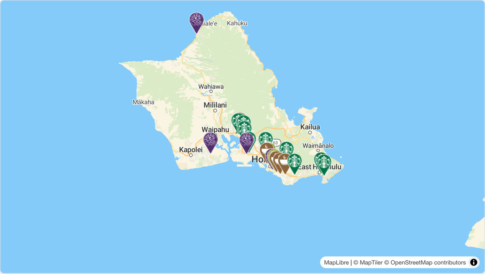

# @mapconductor/react-for-maptiler

MapTiler provider for the MapConductor React SDK. Renders a MapTiler Cloud map
(via MapLibre GL JS) through MapConductor's provider-independent camera, marker,
and overlay API, so the same application code can also run on Google Maps,
MapLibre, Mapbox, Leaflet, OpenLayers, ArcGIS, Cesium, HERE, or TomTom.

## Demo

[](https://demo-react.mapconductor.com/maptiler/map/en)

Open it in the [live demo](https://demo-react.mapconductor.com/maptiler/map/en): the same store map runs on every provider, and the page switches between them. The code, cut down to three stores:

```tsx
import { useMemo, useState } from 'react';
import {
  createGeoPoint,
  createMapCameraPosition,
  createMarkerState,
  type MarkerState,
} from '@mapconductor/js-sdk-core';
import { InfoBubble, Markers } from '@mapconductor/js-sdk-react';
import { MapTilerDesign, MapTilerMapView2D, useMapTilerViewState } from '@mapconductor/react-for-maptiler';
import '@mapconductor/react-for-maptiler/style.css';

const STORES = [
  { id: 'waikiki', name: 'Waikiki', latitude: 21.2793, longitude: -157.8292 },
  { id: 'kailua', name: 'Kailua', latitude: 21.3972, longitude: -157.7394 },
  { id: 'haleiwa', name: 'Haleiwa', latitude: 21.5928, longitude: -158.1034 },
];

const INITIAL_CAMERA = createMapCameraPosition({
  position: createGeoPoint({ latitude: 21.38, longitude: -157.93 }),
  zoom: 10,
});

export default function App() {
  const mapViewState = useMapTilerViewState({
    apiKey: 'YOUR_MAPTILER_API_KEY',
    mapDesignType: MapTilerDesign.Streets,
    cameraPosition: INITIAL_CAMERA,
  });
  const [selected, setSelected] = useState<MarkerState | null>(null);
  const markers = useMemo(
    () =>
      STORES.map(store =>
        createMarkerState({
          id: store.id,
          position: createGeoPoint({ latitude: store.latitude, longitude: store.longitude }),
          extra: store,
          onClick: marker => setSelected(marker),
        }),
      ),
    [],
  );

  return (
    <div style={{ width: '100%', height: '100vh' }}>
      <MapTilerMapView2D state={mapViewState} onMapClick={() => setSelected(null)}>
        <Markers states={markers} />
        {selected && (
          <InfoBubble marker={selected}>
            <strong>{(selected.extra as (typeof STORES)[number]).name}</strong>
          </InfoBubble>
        )}
      </MapTilerMapView2D>
    </div>
  );
}
```

Replace `YOUR_MAPTILER_API_KEY` with your own key.

## Installation

```shell
npm install @mapconductor/react-for-maptiler @mapconductor/js-sdk-core @mapconductor/js-sdk-react
```

`maplibre-gl` (v6) is bundled as a dependency and does the actual rendering.

## API key

MapTiler tiles require a [MapTiler Cloud](https://cloud.maptiler.com/) API key.
Pass it to the view state:

```tsx
const state = useMapTilerViewState({
  apiKey: MAPTILER,
  mapDesignType: MapTilerDesign.Streets,
  cameraPosition,
});
```

## Usage

```tsx
import {
  MapTilerDesign,
  MapTilerMapView2D,
  useMapTilerViewState,
} from '@mapconductor/react-for-maptiler';
import '@mapconductor/react-for-maptiler/style.css';
import { MapCameraPosition, createGeoPoint } from '@mapconductor/js-sdk-core';

// Your own key. Read it from your environment however your build tool does
// it, and keep it out of source control.
const MAPTILER = '…';

function Map() {
  const state = useMapTilerViewState({
    apiKey: MAPTILER,
    mapDesignType: MapTilerDesign.Streets,
    cameraPosition: MapCameraPosition.create({
      position: createGeoPoint({ latitude: 35.6812, longitude: 139.7671 }),
      zoom: 11,
    }),
  });

  return <MapTilerMapView2D state={state} />;
}
```

## Bundler setup (MapLibre GL JS v6)

MapTiler renders through MapLibre GL JS. MapLibre GL JS v6 is ESM-only and loads
its Web Worker from a URL. With a bundler (Vite, webpack, esbuild, Rollup) that
URL must be registered once, before the first map is created. This package
re-exports maplibre's `setWorkerUrl` as `setMapTilerWorkerUrl` so you can do it
without importing `maplibre-gl` directly — useful when you depend on
`@mapconductor/react-for-maptiler` alone:

```ts
// Vite
import { setMapTilerWorkerUrl } from '@mapconductor/react-for-maptiler';
import workerUrl from 'maplibre-gl/dist/maplibre-gl-worker.mjs?worker&url';

setMapTilerWorkerUrl(workerUrl);
```

```ts
// webpack 5+ / esbuild / Rollup (after copying the worker next to your bundle)
import { setMapTilerWorkerUrl } from '@mapconductor/react-for-maptiler';

setMapTilerWorkerUrl(new URL('maplibre-gl/dist/maplibre-gl-worker.mjs', import.meta.url).toString());
```

In many setups (e.g. Vite) MapLibre GL v6 resolves the worker automatically and
this call is unnecessary. It is also redundant if you already register the
worker through `@mapconductor/react-for-maplibre` in the same app: both share the
single deduped `maplibre-gl` instance, so one registration covers both. For SSR
with Vite, add `maplibre-gl` to `ssr.noExternal` so the worker-URL import
resolves through Vite.

## Available designs

`MapTilerDesign` exposes MapTiler Cloud reference styles, mirroring the android
`MapTilerDesign`: `Streets`, `StreetsDark`, `StreetsLight`, `Basic`, `Bright`,
`Satellite`, `Outdoor`, `Winter`, `Topo`, `Toner`, `Dataviz`, `Backdrop`,
`Ocean`, `Landscape`, `Aquarelle`, `OpenStreetMap`.

## License

Apache-2.0
